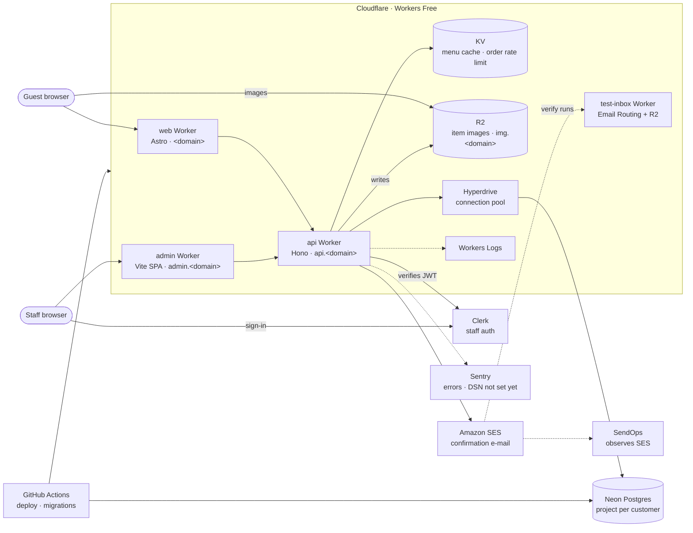

# Piccolo

Online lunch ordering for Piccolo Club Étterem, Szombathely. Guests order the weekly menu without an
account; staff publish the menu and process the orders.

Start with [AGENTS.md](AGENTS.md) for the layout, commands and branch policy, then
[docs/PLAN.md](docs/PLAN.md) and [docs/STACK.md](docs/STACK.md).

## External services

- **Cloudflare** runs three Workers per customer, each on its own hostname. The frontends call the
  API cross-origin. The api Worker's bindings and secrets are listed in
  [apps/api/README.md](apps/api/README.md).
- **Neon** is reached only through Hyperdrive when deployed; locally `DATABASE_URL` connects
  directly.
- **SES** is called with `aws4fetch`, not the AWS SDK. SendOps watches deliveries and is not in the
  sending path.
- **Sentry** is wired into the API (`@sentry/cloudflare`) but stays off until `SENTRY_DSN` is set.
- **test-inbox** is test tooling for the verify skill, one for the whole project, not deployed by
  CI. See [apps/test-inbox/README.md](apps/test-inbox/README.md).
- **Google Maps** appears only as a directions link on the landing page.
